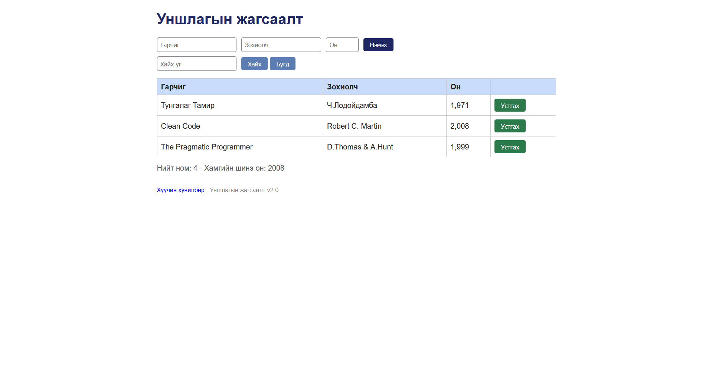

# BUG-01: «Нийт ном» тоолуур хүснэгтэд байгаа номын тооноос 1-ээр илүү байна

Орчин: Уншлагын жагсаалт v2.0, Chrome 131, Windows 11, 2026-10-25

Урьдчилсан нөхцөл: node app.js-ийг шинээр асаасан (анхны 3 ном)

## Дахин гаргах алхам

1. Браузераар http://localhost:3000 нээнэ.

2. Хүснэгтэд харагдаж буй номыг тоолно (3 ном).

3. Хүснэгтийн доорх «Нийт ном» мөрийг харна.

Хүлээгдэж байсан: Спецификац: «Нийт ном» тоолуур хүснэгтэд буй номын тоотой тэнцүү байх ёстой, өөрөөр хэлбэл 3.

Бодит үр дүн: «Нийт ном: 4» гэж харагдана, хүснэгтэд зөвхөн 3 ном байна.

Ноцтой байдал: Major, хэрэглэгчид номын тоог буруу харуулж төөрөгдүүлнэ.

Хавсралт:

Олдсон аялал: Supermodel (GUI)