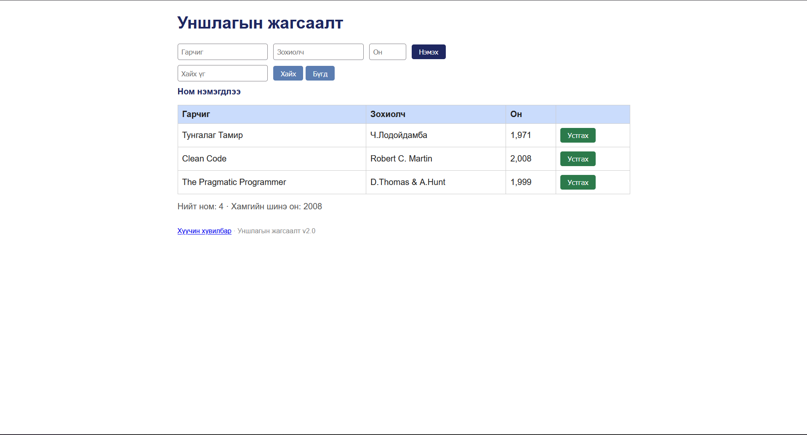

# BUG-02: «Устгах» товч улаан биш, ногоон өнгөтэй байна

Орчин: Уншлагын жагсаалт v2.0, Chrome 131, Windows 11, 2026-10-25

Урьдчилсан нөхцөл: node app.js-ийг шинээр асаасан (анхны 3 ном)

## Дахин гаргах алхам

1. Браузераар http://localhost:3000 нээнэ.

2. Хүснэгтийн баруун талын «Устгах» товчнуудын өнгийг харна.

Хүлээгдэж байсан: Спецификац: «Аюултай үйлдлийн товч (Устгах) улаан өнгөтэй».

Бодит үр дүн: «Устгах» товч бүр ногоон өнгөтэй.

Ноцтой байдал: Minor, үйл ажиллагаанд нөлөөгүй ч аюултай үйлдлийг ялгах өнгөн дохио байхгүй.

Хавсралт:

Олдсон аялал: Supermodel (GUI)