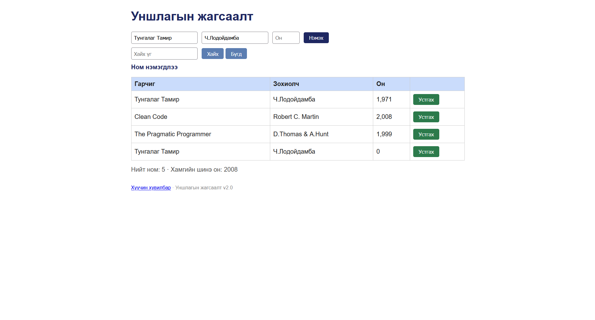

# BUG-03: «Хуучин хувилбар» линк дээр дарахад «Internal Server Error» гарна

Орчин: Уншлагын жагсаалт v2.0, Chrome 131, Windows 11, 2026-10-25

Урьдчилсан нөхцөл: node app.js-ийг шинээр асаасан (анхны 3 ном)

## Дахин гаргах алхам

1. Браузераар http://localhost:3000 нээнэ.

2. Хуудасны доод талын «Хуучин хувилбар» линк дээр дарна.

Хүлээгдэж байсан: Спецификац: «бүх хуудас, линк ажиллана», өөрөөр хэлбэл хуудас нээгдэх ёстой.

Бодит үр дүн: Хуудас нээгдэхгүй, «Internal Server Error» гэсэн текст гарна (хаяг нь /old).

Ноцтой байдал: Major, апп дээрх линк ажиллахгүй байна.

Хавсралт:

Олдсон аялал: Supermodel (GUI)